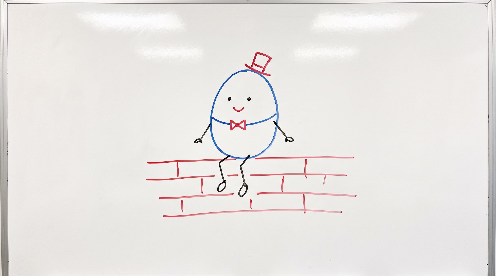

# Humpty

This is a humidity and temperature measurement project. Using the DHT11 humidity and temperature sensor, with readings displayed on an ssd1306 128x64 display.
Development framework is ESP-IDF with C.

### How to use
1. Install ESP-IDF on your machine and activate the idf environment.
2. Clone this repository `git clone git@github.com:gboyegaoyeniyi/humpty.git`
3. Set your chip target to esp32, i.e `idf.py set-target esp32`
4. Connect the sensor and display to the correct pin and power sources - check the connection guide
5. Build the firmware and flash the chip `idf.py build && idf.py flash`

And you get humpty running.

### How to Connect the Components
Check the [Kconfig](main/Kconfig.projbuild) for the default pin assignment used in this project.

#### DHT11
1. Connect the GND to GND(ground)
2. VCC to 3v3 for power
3. DATA (out / s) to any available gpio pin - I used pin 4 in this project. Remember to set the numbers in the `idf.py menuconfig`

#### ssd1306
The particular display used in this project is a 4 pin version
1. Connect the GND to GND(ground)
2. VCC to 3v3 for power
3. SCL to any available gpio pin in this project I used pin 22
4. SDA to any available gpio pin in this project I used pin 21

### Why I Named it Humpty
One thing I hate is giving a long name to a project, it frustrates me while trying to `cd` into it in a shell. For example I originally named it `weather_station` and then I realised `cd weather_station` is a hassle.
So I looked for something that combined the functionality of the project, I arrived at `hum_t` short for for humdity and temperature. Then I remembered recently listening to the nursery rhyme `Humpty Dumpty`, and that's how I got the name.

